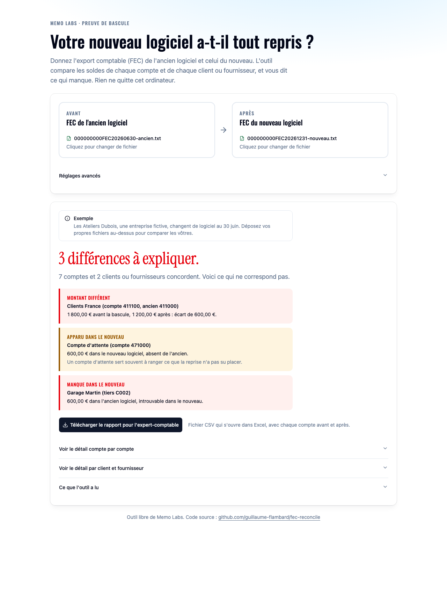

# fec-reconcile

**Votre nouveau logiciel comptable a-t-il tout repris ?** Quand une entreprise change de logiciel
(Sage vers Odoo, NAV vers Business Central...), ses soldes doivent arriver à l'identique. Cet outil
compare l'export comptable (FEC) de l'ancien logiciel à celui du nouveau, compte par compte et
client ou fournisseur par client ou fournisseur, et dit en clair ce qui manque ou a changé.



- **Ce qu'il trouve** : une facture client oubliée à la reprise, un montant rangé sur un compte
  d'attente, un solde fournisseur au mauvais signe, un écart d'un centime.
- **Ce qu'il produit** : la table de correspondance et de réconciliation que l'administration fiscale
  demande quand le plan de comptes change ([BOFiP BOI-CF-IOR-60-40-20, § 400](https://bofip.impots.gouv.fr/bofip/9028-PGP.html/identifiant=BOI-CF-IOR-60-40-20-20170607)),
  en CSV pour Excel.
- **Confidentialité** : il tourne sur votre ordinateur. Les fichiers ne sont envoyés nulle part.
- **Formats lus** : les FEC conformes au texte (tabulation ou « | », UTF-8 ou ISO 8859-15), et les
  écarts courants : fichier réenregistré dans Excel avec des « ; », encodage Windows, guillemets,
  dates en JJ/MM/AAAA. Testé sur des exports publics d'Odoo et de Tiime ; pas encore sur un export
  Sage ou Cegid réel.

Il sert d'instrument à la prestation « preuve de bascule » de Memo Labs :
[memolabs.dev/fr/services/erp-cutover-proof](https://memolabs.dev/fr/services/erp-cutover-proof).
Licence libre (MIT). L'installation demande Java 25 et Node.js (voir plus bas), ou une démonstration
sur vos propres fichiers : contact@memolabs.dev.

---

Compare the accounting of an old system with the new one before an ERP cutover, from the two
FEC files (fichier des écritures comptables, the export every French accounting software must
produce). The tool lists every account and every third party whose balance differs, and writes
the correspondence and reconciliation table that the tax administration asks for when a change
of software also changes the chart of accounts.

Status: prototype, 25 November 2026. Tested on eight public FEC files (including Odoo and Tiime
exports), on a migration simulated from the Odoo file with three known mistakes (all three found,
nothing else), and on 300 000 lines per file (3.6 s). Not yet run on a real company's migration.

## Why

When a company changes software during a financial year and changes its chart of accounts,
BOFiP [BOI-CF-IOR-60-40-20 § 400](https://bofip.impots.gouv.fr/bofip/9028-PGP.html/identifiant=BOI-CF-IOR-60-40-20-20170607)
asks for two FEC and "tables de correspondances et de réconciliation comptable" between the two
systems. Existing open source FEC tools check one file at a time; this one compares two.

Entries are never matched one by one: the new software renumbers imported entries, so the
comparison works on balances per account and per third party.

## Run it

Requirements: JDK 25 or later (the build refuses an older one), Node 22.22 or later.
On macOS with Homebrew: `brew install openjdk@25`, then point `JAVA_HOME` at it:

```bash
export JAVA_HOME=$(brew --prefix openjdk@25)/libexec/openjdk.jdk/Contents/Home
```

```bash
cd backend && ./mvnw spring-boot:run      # API on http://127.0.0.1:8080
cd frontend && npm install && npm start   # screen on http://localhost:4200
```

Open the screen and click "Essayer avec l'exemple" to run the fictional sample in `samples/`.

The API listens on 127.0.0.1 only. Files are read in memory and never written to disk or logged.

## What it compares

- **Opening mode** (default when the new FEC has AN, RAN or ANO entries): the closing balance of
  the old FEC against the opening entries of the new one.
- **Full mode**: both files hold the same history and are compared as a whole.
- An optional `old;new` CSV maps the old accounts to the new chart. Third parties are compared
  on their code, without mapping.
- Classes 6 and 7 can be left out for a cutover at year end.

Accepted formats follow article A47 A-1 of the LPF: tab or pipe separated, UTF-8 or ISO 8859-15,
dates as AAAAMMJJ, decimal comma, Debit and Credit or Montant and Sens.

## Checks

```bash
cd backend && ./mvnw test
cd frontend && npx ng lint && npx ng test --watch=false && npx ng build
```

## Stack

Java 25, Spring Boot 4.2, Maven; Angular 22 (standalone, zoneless, signals), spartan/ui on
Tailwind CSS 4, Vitest, angular-eslint.

## Licence

MIT, see `LICENSE`. The agent skills in `.claude/skills/` keep their own licences, listed in
`.claude/skills/SOURCES.md`. The sample files describe a fictional company.
